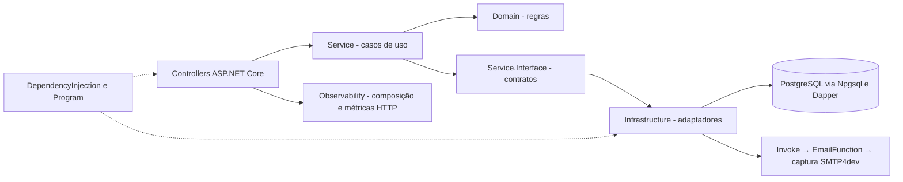

# Sistema de Gerenciamento de Mecânica

API .NET da oficina: usuários, clientes, veículos, catálogo, estoque e ciclo de ordens de serviço. Reúne regras de negócio, persistência PostgreSQL, autenticação interna, notificações e observabilidade. A validação cadastral de clientes é uma Lambda separada.

## Estado e evidências

E4/E5/E6 foram concluídas no **escopo hom acordado**, incluindo JWT entre Lambda/API, autorização, histórico/estoque, telemetria, dashboards e alertas no alcance registrado. O ambiente foi destruído em 21/10/2026; não há endpoint hom ativo. Prd/coexistência, carga e demais cenários dispensados não foram comprovados. Workflows são manuais, sem deploy automático após merge; análise da diferença R06 foi adiada.

- [Revisão integrada e fontes](docs/REVISAO_E6_2026-10-21.md).
- [PRs, CI/CD e proteções](docs/EVIDENCIAS_CICD_E_PROTECOES_2026-10-21.md).
- [Observabilidade: aceite e limitações](docs/ENCERRAMENTO_E5_2026-10-21.md).
- [VersionId SAM e proteção de artefatos](docs/VALIDACAO_PROTECAO_ARTEFATOS_2026-10-21.md).
- [Descarte final, persistências e custos estimados](docs/ENCERRAMENTO_E6_E_CUSTOS_2026-10-21.md).

A próxima etapa é documentação/vídeo/PDF da entrega. Avisos transitivos de dependências/analisadores e limites aceitos não foram corrigidos ou ocultados por esta revisão documental.

## Componentes e repositórios



| Repositório | Responsabilidade |
|---|---|
| Este | API/camadas/testes, Dockerfile/Compose, Deployment/HPA/ServiceAccount, OpenAPI e Auth.Contracts |
| [Infraestrutura](https://github.com/pknfelps/GerenciamentoMecanicaInfraestrutura/tree/develop) | Bootstrap/rede/EKS/NLB/Service, Gateway, Collector Kubernetes e recursos New Relic |
| [Banco](https://github.com/pknfelps/GerenciamentoMecanicaBancoDados/tree/develop) | RDS/credenciais, SQL/seeds e Job de inicialização |
| [Autenticação](https://github.com/pknfelps/GerenciamentoMecanicaServerless/tree/develop) | Lambda/SAM, documento CPF/CNPJ e JWT Customer |

Domain.Interface/Service.Interface definem contratos. Infrastructure implementa PostgreSQL, JWT/hash e envio; DependencyInjection compõe os serviços. Consultas públicas de usuários não retornam senha/hash. [Componentes AWS](docs/arquitetura/diagramas/COMPONENTES.md), [sequências](docs/arquitetura/README.md) e [banco/ER](docs/arquitetura/BANCO_E_MODELO.md).

## Tecnologias e build

.NET SDK 10/ASP.NET Core, PostgreSQL 16, Npgsql/Dapper, JWT HS256, OpenTelemetry, Docker/Compose, Kubernetes/Kustomize, GitHub Actions e SonarCloud. Docker com engine Linux deve estar ativo para a suíte completa PostgreSQL/Testcontainers; os testes não usam o banco do Compose e não devem ser ignorados por indisponibilidade.

```bash
dotnet restore GerenciamentoMecanicaSistema.slnx
dotnet build GerenciamentoMecanicaSistema.slnx -c Release --no-restore
dotnet test GerenciamentoMecanicaSistema.slnx -c Release --no-build --no-restore
```

Restore/build não precisam de banco ou AWS ativos. [Dockerfile](GerenciamentoMecanicaSistema/Dockerfile) usa build/publish SDK 10 e runtime ASP.NET 10, porta 8080 e usuário não root; inclui certificado público RDS. Para conferir apenas o build da imagem:

```bash
docker build --file GerenciamentoMecanicaSistema/Dockerfile --tag gerenciamento-mecanica-api:local .
```

## Execução local opcional

1. Copiar [.env.example](.env.example) para .env; definir POSTGRES_PASSWORD e JWT_KEY com pelo menos 32 caracteres. .env é ignorado pelo Git.
2. Executar `docker compose up -d db smtp`.
3. Preparar banco **vazio** com o SQL do [repositório de banco](https://github.com/pknfelps/GerenciamentoMecanicaBancoDados/blob/develop/README.md#execução-local-opcional). Compose não cria tabelas/seeds nem sincroniza arquivos entre repositórios.
4. Iniciar a EmailFunction no SAM local conforme o [procedimento AE.7](docs/AE7_API_ENVIO_E_ACESSO_CUSTOMER.md), usando a rede do Compose e listener acessível ao container. Depois executar `docker compose up --build -d api`; conferir `docker compose ps` e `docker compose logs -f api`.

O SMTP4dev usa a [configuração local](deploy/smtp4dev/appsettings.json): caixa em memória, no máximo 100 mensagens/sessões, relay desabilitado e conteúdo ausente do stdout. Reiniciar perde a caixa. O volume SMTP antigo deixa de ser montado, sem exclusão automática; o volume db_data permanece.

O [Compose](docker-compose.yaml) publica portas somente em loopback. Sem Runtime__Environment, usa conexão/JWT locais e Invoke no SAM/EmailFunction para captura SMTP4dev. Definir runtime hom/prd ativa o carregamento AWS e exige alias email/v1 desse ambiente, sem override de endpoint ou fallback de simulação. Não cria modo local alternativo de AWS.

| Serviço | URL/porta padrão |
|---|---|
| API | http://localhost:8080 |
| Swagger UI, somente Development | http://localhost:8080/swagger |
| OpenAPI, somente Development | http://localhost:8080/openapi/v1.json |
| Readiness | http://localhost:8080/health/ready |
| PostgreSQL | localhost:5432 |
| smtp4dev / SMTP | http://localhost:3000 / localhost:2525 |

As portas são ajustáveis no .env. `docker compose down` preserva volumes; `docker compose down --volumes` apaga dados locais e exige preparar o banco vazio novamente. Não usar esse fluxo para apagar dados AWS.

## Autenticação, autorização e Postman

Seeds educacionais: Admin/Admin@123 e Mechanic/Mechanic@123, com hash PBKDF2. Login `POST /Authentication` recebe name/password/role e retorna JWT como string JSON. Perfis internos aceitos: Admin/Mechanic; credenciais incorretas retornam 401 e request/perfil inválido 400. Usar `Authorization: Bearer <token>` nas rotas protegidas.

| Identidade | Operações |
|---|---|
| Admin | Criar/consultar/remover usuários internos e PATCH da própria conta |
| Mechanic | Cadastros operacionais/OS, GET/PATCH da própria conta e consulta de status |
| Customer | JWT emitido pela Lambda; status e decisão de orçamento apenas das próprias OSs |

Admin não herda acesso operacional. Customer não é linha de users. JWT contém Name/Role/NameIdentifier UUID, HS256 e expiração UTC + dez minutos; a validação mantém tolerância de relógio de cinco minutos. Não há refresh/revogação por atualização, remoção ou inativação; operações próprias ainda dependem do cadastro/vínculo.

PATCH /Users aceita somente name/password, pelo menos um presente; omitido preserva, nulo/vazio/desconhecido é inválido. UUID vem exclusivamente do JWT; não altera id/role. Sucesso 204, request 400, autenticação 401, perfil 403, conta ausente 404 e conflito de nome no mesmo perfil 409. DELETE /Users?id=<uuid> exige Admin, remove somente users, retorna 204/404; sem proteção de autoexclusão/último Admin. Recriar nome não transfere identidade de token anterior.

Clientes nascem Active; PATCH cadastral não altera status e não há endpoint de inativação. Cliente Inactive não obtém novo JWT pela Lambda, sem revogar sessão emitida antes. OS de terceiro/ausente ou cliente necessário ausente retorna 404 genérico; orçamento exige Customer e documento correspondente, com 422 para divergência/estado incompatível.

Importar [collections](postman/collections) e [ambiente Postman](postman/environments/Dev.environment.yaml). Configurar base_url/gateway_url incluindo stage; logins preenchem admin_token/mechanic_token, e ValidateCustomerDocument preenche customer_token. Variáveis começam vazias. As coleções antigas ainda usam a rota de autenticação anterior; serão alinhadas na AE.9. No contrato AE local, usar request-code/verify-code e orçamento somente com approved. DELETE Users usa user_id da conta alvo. [Contrato completo](docs/arquitetura/ACESSO_E_AUTENTICACAO.md).

## OS, histórico e notificações

Mechanic abre a OS; diagnóstico → orçamento Customer → execução → entrega, com ramo de recusa. Estoque/itens/OS/eventos confirmam na mesma transação. Mutações bloqueiam a OS e materiais seguem ordem de UUID. Histórico sobrevive ao DELETE individual, mas não à destruição do banco; não há CHECK/índice/UNIQUE de sequência no SQL por decisão registrada.

Datas são derivadas: abertura do evento inicial e conclusão Finished/ServiceCompleted. Sem conclusão, dateFinished/duration são null; recusa não é serviço concluído e duração real zero é válida. Entrega não aumenta o tempo do serviço. [Modelo e ER](docs/arquitetura/BANCO_E_MODELO.md).

Após commit o serviço publica e aguarda o handler; ele consulta dados/monta a mensagem e trata falhas sem desfazer a OS. Todos os modos invocam EmailFunction, que transmite ao SMTP4dev sem relay externo. A API não mantém SMTP direto ou logging de simulação. Sucesso significa captura, sem entrega pessoal ao destinatário. Não há fila/outbox/reprocessamento/garantia única. [Sequência](docs/arquitetura/diagramas/ABERTURA_OS.md) e [melhoria futura](docs/arquitetura/adrs/006-NOTIFICACOES.md).

## Configuração AWS, saúde e observabilidade

| Configuração | Comportamento |
|---|---|
| ConnectionStrings__DefaultConnection | PostgreSQL local |
| Jwt__Issuer / Jwt__Audience / Jwt__Key | JWT local |
| Runtime__Environment | Ausente: local/SAM; hom/prd: bootstrap AWS/alias email; vazio/inválido rejeitado |
| AWS_REGION | us-east-1 no modo AWS |
| Email__InvocationEndpoint / Email__FunctionName | Local: SAM HTTP permitido / EmailFunction; AWS: alias via catálogo, sem endpoint override |
| Telemetry__Enabled | Opt-in local; hom true e prd false nos overlays atuais |
| OTEL_EXPORTER_OTLP_ENDPOINT | Destino OTLP absoluto HTTP/HTTPS, sem credenciais/query/fragmento |

Bootstrap lê SSM v2/AWSCURRENT de JWT e database/api, com prazo total de 45 s, identidade por Pod Identity e valores em memória. TLS VerifyFull/CA RDS; sem fallback local em modo AWS ou Secret Kubernetes JWT. Erro inicial encerra com código 1 e mensagem fixa/tipo no stderr, sem stack trace. [Inicialização](docs/INICIALIZACAO_AWS.md).

Probes anônimas: /health/startup, /health/ready e /health/live; não são publicadas pelo Gateway. Swagger/OpenAPI só são habilitados em Development, não em Staging/Production.

OTel usa o [manifesto](deploy/kubernetes/base/observability.json), ConfigMap estável read-only e um provider por sinal. Métricas identificam acontecimentos; configuração seleciona atributos/dimensões/coleta. Console textual é preservado, sem escopos/caminho bruto, mensagem original de exceção, stack trace, SQL, documento, token ou credenciais. Atributos técnicos e IDs de correlação são permitidos; UUID/OS não são dimensões de métricas.

W3C traceparent é o único pai OTLP, sem baggage/tracestate. HTTP/PostgreSQL/logs correlacionados; probes/SQL associado sem spans, preservando métricas. X-Ray/polling é separado. Exportação usa Collector da infraestrutura e não recebe License Key na API. [Procedimento local](docs/OBSERVABILIDADE_LOCAL.md), [indicadores](docs/OBSERVABILIDADE_NEGOCIO.md), [integrações](docs/METRICAS_INTEGRACOES.md), [tracing](docs/TRACING_W3C_E_XRAY.md) e [aceite/limites E5](docs/ENCERRAMENTO_E5_2026-10-21.md).

## OpenAPI, pipelines e deploy

```bash
dotnet build GerenciamentoMecanicaSistema.slnx -c Release -p:OpenApiGenerateDocuments=true
```

Gera artifacts/openapi/openapi.json, OpenAPI 3.0, sem AWS/JWT/persistência. Build comum/Docker não gera. Bearer por operação reflete Authorize/AllowAnonymous. A API não implementa /customers/validate, atendido exclusivamente pela Lambda.

| Workflow | Comportamento |
|---|---|
| [pipeline](.github/workflows/pipeline.yml) | PR/manual: testes, cobertura/SonarCloud e build de imagem; sem push/deploy |
| [auth-contracts](.github/workflows/auth-contracts.yml) | Verifica/empacota nupkg; publicação manual condicionada ao input publish |
| [api-deploy](.github/workflows/api-deploy.yml) | Manual: Publicar → Implantar, sem aprovação intermediária; Release/OpenAPI/ECR/digest/Kustomize/rollout |
| [api-destroy](.github/workflows/api-destroy.yml) | Manual: checar Gateway, remover overlay/recursos da API e conferir ausência |
| [aws-oidc-check](.github/workflows/aws-oidc-check.yml) | Diagnóstico manual de identidade/acesso, não prova completa de deploy |

Deploy exige develop/hom ou main/prd, OIDC/Environments, bootstrap/base/Collector/banco/Job disponíveis e License Key cadastrada pelo mantenedor. Mesma revisão nos dois jobs; tag sha-commit-run-attempt e deploy por digest. Contrato/checksum S3 são imutáveis por commit. Não publica /api/v2/ nem usa estado de outro repositório. Aguarda rollout por 600 s; diagnóstico sem rollback automático próprio.

[Kustomize base/hom/prd](deploy/kubernetes) e [procedimento completo](docs/DEPLOY_API.md). Deployment/HPA/ServiceAccount pertencem à API; Service/NLB à infraestrutura. Base local Kustomize mantém referências locais anteriores; overlays AWS removem db-secrets e usam identidade/runtime AWS. Docker Hub dessa base não é o caminho de publicação AWS.

Provisionar: bootstrap → base/Collector → banco/Job → API e auth → Gateway. Descartar: Gateway → API/auth → banco → base, com [bloqueios de dependência](docs/DESTRUICAO_AMBIENTE.md). ECR/artefatos/estados e recursos New Relic persistem. Sem deploy automático por push/merge ou aprovação implícita de operações futuras.

O endpoint ativo é obtido de /mecanica/<ambiente>/gateway/v2/endpoint após provisionamento. Não usar URLs de rodadas destruídas. [GitHub Actions](https://github.com/pknfelps/GerenciamentoMecanicaSistema/actions) · [Arquitetura/ADRs/RFCs](docs/arquitetura/README.md) · [Operação New Relic](https://github.com/pknfelps/GerenciamentoMecanicaInfraestrutura/blob/develop/docs/NEW_RELIC.md). Vídeo/PDF ainda pertencem à próxima parte da E7. Por decisão do mantenedor, o acesso ocorre pelos quatro repositórios públicos, sem convite individual de avaliadores; visibilidade confirmada no GitHub em 21/10/2026.


## Refinamento extra planejado — autenticação e envio de e-mails

Decisão de 22/10/2026, com autenticação/envio e integração da API comprovados localmente, publicação pendente: cliente solicita/confirma código, lê-se a mensagem capturada no SMTP4dev privado para os testes e a autenticação emite JWT Customer sem vínculo a OS. A API continua responsável por titularidade/Active e decisão de orçamento, com retorno 200/Approved ou Refused e approved explícito. O transporte de e-mail está centralizado em EmailFunction, invocada pela API e AuthFunction na implementação local. SMTP4dev AWS não terá persistência de mensagens ou relay externo; desafios ficam no PostgreSQL.

O repositório de funções agora é GerenciamentoMecanicaServerless. AE.2 organizou AuthFunction/AuthFunctionTests, estrutura EmailFunction/EmailFunctionTests e caminhos auth, preservando contratos e recursos existentes. GitHub/raiz/remote renomeados, proteções/Environments e CI/OIDC conferidos. Transição inicial e retirada da confiança antiga aprovadas/aplicadas; Terraform posterior sem diferenças. A função de envio tem handler, transporte e template SAM preparados/validados localmente na AE.5; os consumidores e workflows ainda serão integrados. Nenhum deploy da função email foi executado. Os checklists oficiais E5/E6/E7 permanecem separados. [Plano extra AE.1–AE.10](docs/PLANO_EXTRA_AUTENTICACAO_E_EMAIL.md).

AE.1–AE.7 preparadas e validadas nos seus respectivos escopos em 22/10/2026: [contratos HTTP/JWT/Invoke](docs/CONTRATOS_EXTRA_AUTENTICACAO_E_EMAIL.md) e [migração/OIDC](docs/AE2_FINALIZACAO_OIDC_2026-10-22.md). [EmailFunction e evidências locais](https://github.com/pknfelps/GerenciamentoMecanicaServerless/blob/develop/docs/AE5_EMAIL_FUNCTION.md): regressão de 419 testes aprovada e captura SAM/Compose conferida. [Autenticação por código implementada e validada localmente na AE.6](https://github.com/pknfelps/GerenciamentoMecanicaServerless/blob/develop/docs/AE6_AUTENTICACAO_POR_CODIGO.md), com 438 testes aprovados e publicação coordenada ainda pendente. Endpoints da API preservados; a próxima etapa extra é AE.8 — SAM, workflows e Gateway. [AE.7 concluída localmente](docs/AE7_API_ENVIO_E_ACESSO_CUSTOMER.md): envio central, cliente ativo, orçamento explícito e 1.212 testes aprovados, sem implantação. Alterações locais seguem para PR do mantenedor.

A aprovação de orçamento agora recebe somente approved booleano e retorna 200 com decision Approved/Refused; cadastro Customer inativo recebe 403 antes de consultar a OS. A expiração JWT é estrita (ClockSkew zero), inclusive para usuários internos. O contrato/OpenAPI novo e a autenticação por código serão publicados coordenadamente na AE.8.

## Extra AE.8 — publicação coordenada preparada

[Workflows auth/email e Gateway](https://github.com/pknfelps/GerenciamentoMecanicaServerless/blob/develop/docs/AE8_WORKFLOWS_E_GATEWAY.md) preparados e validados localmente. api-deploy confere email/v1 (alias live do ambiente e contrato 1) antes de aplicar o Deployment; isso é conferência de metadados, não teste de SMTP. Bootstrap deve ser aprovado/aplicado antes de usar o novo guard. Provisionamento: base/SMTP4dev → banco e email → API/auth → Gateway com contratos novos. Nenhum workflow remoto ou deploy foi executado nesta etapa; Postman/roteiro conjunto seguem na AE.9.
