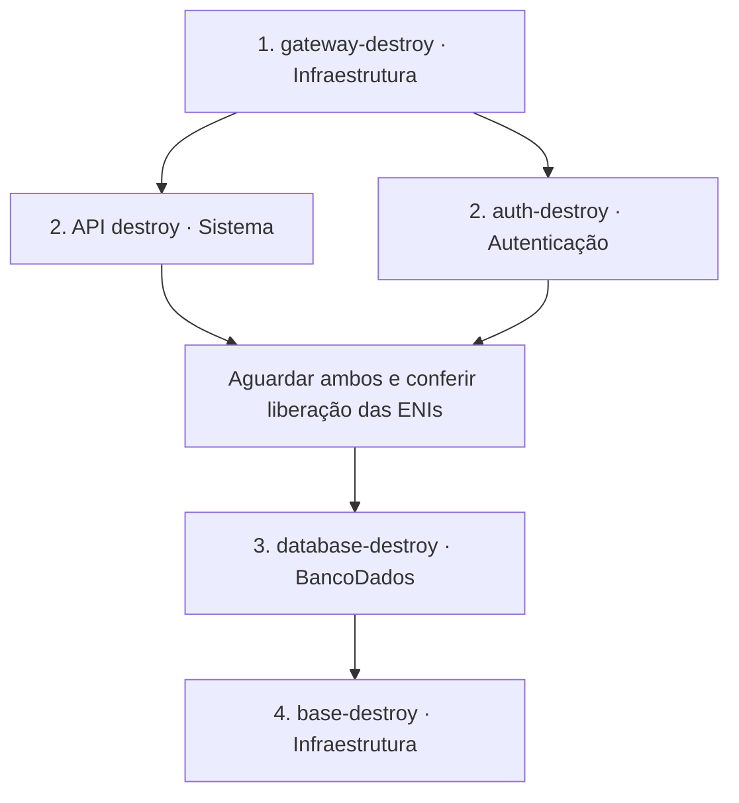

# Mapa de descarte do ambiente AWS

Conferido em 15/10/2026 nos workflows versionados dos repositórios. Este documento é um roteiro; nenhum destroy foi executado para produzi-lo.

Para o ambiente atual, selecionar **branch `develop` e environment `hom`** em todos os workflows. Para produção, a correspondência é `main`/`prd`. Não misturar ambientes nem iniciar provisionamentos/deploys enquanto o descarte estiver em andamento.

## Workflows e entradas

| Fase | Repositório | Workflow | Entradas | Aprovação |
|---|---|---|---|---|
| 1 | GerenciamentoMecanicaInfraestrutura | `gateway-destroy` | `environment`, `api_commit`, `auth_commit` | Plano Terraform → aprovação → apply salvo |
| 2, em paralelo | GerenciamentoMecanicaSistema | **API destroy** (`api-destroy.yml`) | `environment` | O disparo manual autoriza a execução completa |
| 2, em paralelo | GerenciamentoMecanicaAutenticacao | `auth-destroy` | `environment` | O disparo manual autoriza o `sam delete` |
| 3 | GerenciamentoMecanicaBancoDados | `database-destroy` | `environment` | Plano Terraform → aprovação → apply salvo |
| 4 | GerenciamentoMecanicaInfraestrutura | `base-destroy` | `environment` | Plano Terraform → aprovação → apply salvo |

No `gateway-destroy`, usar os mesmos **SHAs completos dos contratos** informados na última execução bem-sucedida de `gateway-provision`. Consultar os inputs/resumo daquela execução. Não usar digest da imagem, hash SHA-256 de arquivo ou ID da execução. Os contratos e checksums precisam continuar disponíveis no S3 até terminar esse destroy. A base e os parâmetros necessários da autenticação também devem continuar disponíveis durante seu plan/apply.

O `auth-destroy` atual não pede `artifact_commit`; não é necessário executar `auth-publish` antes do descarte. Também não é preciso executar CI ou publicação da API para destruir o ambiente já implantado.

## O que pode rodar em paralelo

Depois de **concluir com sucesso o gateway-destroy**, `API destroy` e `auth-destroy` podem executar simultaneamente: removem consumidores independentes, usam filas distintas e não compartilham estado Terraform.

Antes de avançar ao banco, aguardar o sucesso dos dois e conferir as interfaces de rede restantes da autenticação. O último step de `auth-destroy` **apenas lista as ENIs; não aguarda sua liberação nem falha automaticamente por ainda existirem**. Se aparecerem interfaces ligadas ao SG `mecanica-hom-auth`, aguardar a limpeza da AWS e conferir novamente no EC2 → Network Interfaces, filtrando pelo SG. Não excluir ENIs gerenciadas manualmente. A role de execução persistente deve permanecer para permitir a limpeza.

Não executar `database-destroy` enquanto API ou autenticação estiverem ativas. Não executar `base-destroy` em paralelo com nenhum dos demais: ele remove as dependências de rede, cluster e configurações usadas pelos descartes anteriores. Os grupos de concurrency dos workflows não coordenam repositórios diferentes; essa ordem depende do mantenedor.

## Collector, recursos persistentes e recriação

- Não há destroy separado para o Collector EKS. `base-destroy` remove `kubernetes/observability/<ambiente>`, aguarda a exclusão e depois remove os manifestos da base e aplica o plano Terraform.
- O Collector da Lambda desaparece com a função em `auth-destroy`; a layer pública é preservada.
- `database-destroy` remove o RDS e as credenciais/configurações administradas pelo estado do banco. O histórico SQL deixa de estar disponível após excluir o banco; não presumir recuperação automática dos dados.
- Bootstrap, backends, roles persistentes, bucket compartilhado, ECR/imagens e Secrets New Relic do bootstrap ficam fora do descarte normal. Não executar destroy do bootstrap nem apagar a License Key no New Relic para encerrar hom.
- `sam delete` remove o ZIP referenciado pelo deploy atual e os templates operacionais SAM configurados. Contratos publicados e ZIPs de outras revisões são preservados; versões históricas S3 seguem o versionamento do bucket. Para recriar a mesma revisão, publicar novamente o ZIP antes de provisionar auth.
- Telemetria já recebida no New Relic segue a retenção da conta; esses workflows não a apagam. O outro ambiente não faz parte do descarte selecionado.

Se algum workflow falhar, interromper a sequência e analisar a falha antes de descartar sua dependência. Não cancelar um apply Terraform em andamento nem usar force-unlock sem conferir quem mantém o lock.

## Referências

- [API destroy](../.github/workflows/api-destroy.yml)
- [gateway-destroy](https://github.com/pknfelps/GerenciamentoMecanicaInfraestrutura/blob/develop/.github/workflows/gateway-destroy.yml)
- [auth-destroy](https://github.com/pknfelps/GerenciamentoMecanicaAutenticacao/blob/develop/.github/workflows/auth-destroy.yml)
- [database-destroy](https://github.com/pknfelps/GerenciamentoMecanicaBancoDados/blob/develop/.github/workflows/database-destroy.yml)
- [base-destroy](https://github.com/pknfelps/GerenciamentoMecanicaInfraestrutura/blob/develop/.github/workflows/base-destroy.yml)
