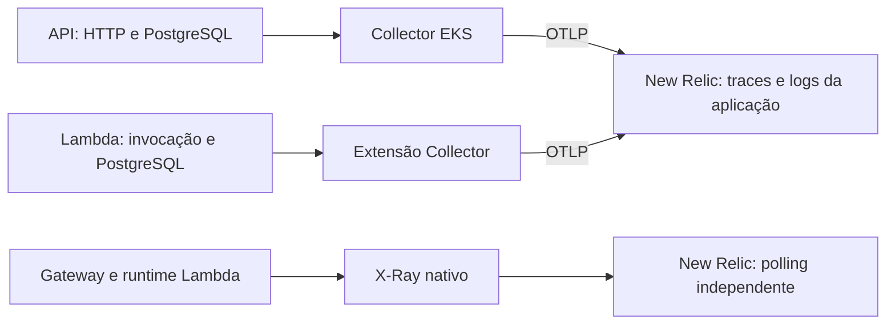

# Tracing W3C e X-Ray separado — 20/10/2026

## Decisão

OpenTelemetry é o tracing principal da API e da autenticação. Os segmentos nativos do Gateway/runtime Lambda continuam disponíveis por X-Ray e polling New Relic como diagnóstico separado. O mantenedor retirou do escopo a árvore única X-Ray/OTLP após a incompatibilidade comprovada nos [dados de hom](VALIDACAO_UNIAO_XRAY_OTLP_2026-10-20.md). A união não foi corrigida nem será marcada como comprovada.

## Comportamento

- Nos dois manifestos, `Telemetry:Propagation:InboundFormats` aceita exclusivamente `["tracecontext"]`. Telemetria habilitada rejeita lista ausente, vazia, repetida ou com outros formatos, inclusive a configuração antiga `xray`. Desabilitada, não registra providers/propagadores nem valida essa seção. OpenAPI da API continua isolado de AWS/telemetria.
- `traceparent` válido define o trace/pai. Sem W3C válido, a instrumentação inicia nova raiz; X-Ray válido não serve de fallback. Valores malformados ou ambíguos seguem o `TraceContextPropagator` oficial, sem parser próprio.
- A API ignora `X-Amzn-Trace-Id`. A Lambda também deixa de ler `_X_AMZN_TRACE_ID`, mantém `DisableAwsXRayContextExtraction=true` e passa explicitamente ao wrapper o contexto W3C selecionado.
- Na Lambda, nomes de cabeçalho são comparados sem distinção de maiúsculas. A chave em `MultiValueHeaders` tem prioridade sobre `Headers`, mesmo quando vazia/inválida/ambígua; as duas representações não são combinadas.
- Entrada/saída descartam baggage/tracestate; saída injeta somente `traceparent`. Não se registram cabeçalhos. Sanitização, sampler, probes, métricas, correlação com PostgreSQL/logs, providers reutilizados e flush continuam preservados.
- A referência direta `OpenTelemetry.Extensions.AWS` foi removida dos dois projetos de entrada. Na Lambda, o pacote continua transitivamente pela instrumentação oficial AWSLambda; isso não ativa a extração X-Ray desabilitada.

Um pai W3C pertencente a sistema externo que não exporta spans ainda pode aparecer ausente no New Relic. A decisão elimina a tentativa de ligar o OTLP ao polling X-Ray; não promete que todo contexto externo terá ancestral disponível. Requisições sem W3C devem apresentar raiz própria, e PostgreSQL deve continuar filho do span HTTP/invocação.

## Publicação e critérios

O mantenedor publicará a API e uma nova versão da autenticação, provisionará a função e atualizará o Gateway para consumir a versão numérica nova. Remover eventuais overrides antigos de `InboundFormats` com `xray`; não criar input, toggle ou variável nova. Coletores, IAM, SAM, tracing nativo, polling e workflows não precisam de alteração.

Após a publicação, conferir separadamente:

1. Sem W3C, inclusive com cabeçalho/runtime X-Ray presente: trace OTLP próprio da aplicação, sem pai nativo AWS.
2. Com W3C válido: trace/pai correspondentes; W3C inválido/ambíguo não usa X-Ray como alternativa.
3. Chamadas consecutivas/concorrentes não reutilizam o contexto anterior. PostgreSQL e logs preservam os IDs da aplicação; entrada não amostrada continua coletada pelo sampler vigente.
4. Probes, respostas HTTP/JWT, métricas e sanitização permanecem iguais. X-Ray/polling são conferidos como fonte independente, sem esperar união automática.

## Validação local

Os testes simples exercitam entradas e saídas dos propagadores/settings, sem exporters fictícios ou suítes de Collector. Foram aprovados **1.196 testes da API e 269 da Lambda**, sem falhas ou ignorados, incluindo a regressão PostgreSQL/Testcontainers com Docker já ativo. Os 24 testes novos da Lambda cobrem somente propagação/configuração; não retomam as antigas suítes de transporte.

Restore e build Release nos dois repositórios, publish linux-x64 sem self-contained, SAM validate --lint/build e Kustomize base/hom/prd passaram. OpenAPI permaneceu byte a byte idêntico: SHA-256 `D784C3B554A65C4F8CFE732C0975B8BFEDAF78D67F9C6ED69E2B07220C5F5D84`, inclusive com configuração AWS/telemetria deliberadamente inválida no processo de geração. Manifestos, collector.yaml/runtimeconfig da Lambda e certificados RDS dos publishes/build SAM foram conferidos. Avisos de dependências/analisadores existentes permaneceram visíveis, sem supressões.

Na conferência HTTP manual da API publicada, o Collector local real 0.161.0 recebeu seis spans para seis chamadas não autenticadas a GET /Users, todas 401. Dois spans continuaram o mesmo pai W3C, inclusive quando havia cabeçalho X-Ray diferente. X-Ray isolado em duas chamadas e W3C inválido com X-Ray válido produziram **três raízes distintas sem pai**. Uma chamada W3C não amostrada continuou o trace/pai esperado e foi exportada pelo sampler vigente. Marcadores fictícios de baggage/tracestate e o trace X-Ray não apareceram na exportação. A probe live retornou 200 sem span; não houve acesso SQL de aplicação nessa checagem. A API encerrou com código 0 e os containers/rede temporários foram removidos.

Essa conferência não simula o runtime gerenciado Lambda nem comprova a nova revisão na AWS. A Lambda foi coberta pelos testes simples de contexto/evento e pela regressão funcional; os vínculos exportados na implantação serão conferidos posteriormente. Evidências locais ignoradas em `artifacts/e5-w3c-only` nos dois repositórios, incluindo `manual-summary.json` da API. Não houve deploy ou alteração AWS/New Relic nesta implementação.

Referências: [mapeamento OTLP no New Relic](https://docs.newrelic.com/docs/opentelemetry/best-practices/opentelemetry-best-practices-traces/) e [contexto nativo Lambda e destinos externos](https://opentelemetry.io/docs/specs/semconv/faas/aws-lambda/).
