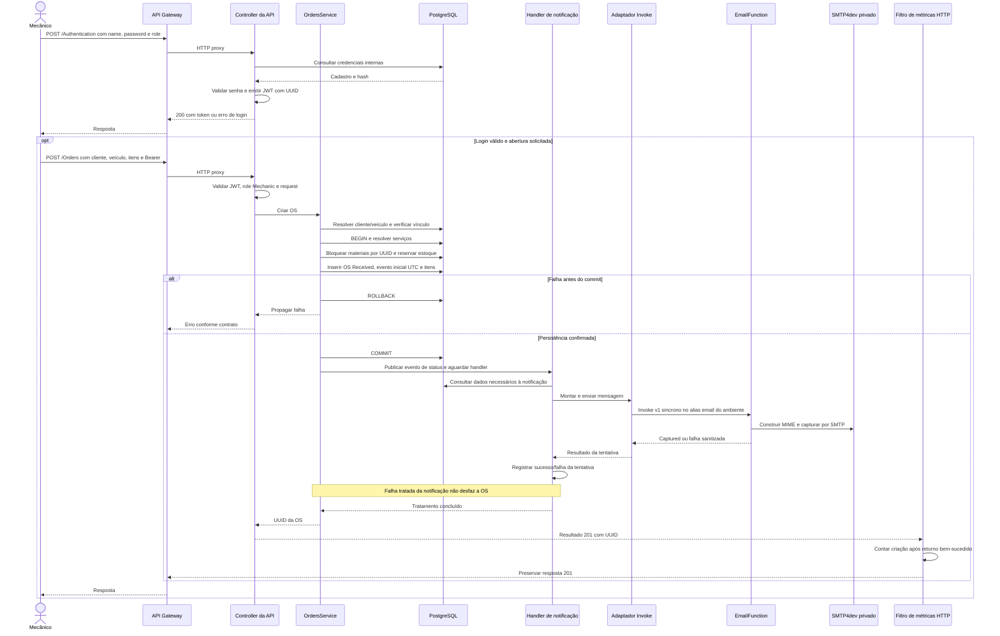

# Login interno e abertura de OS

[Arquitetura](../README.md) · [Permissões](../ACESSO_E_AUTENTICACAO.md) · [Modelo de dados](../BANCO_E_MODELO.md)

Ordem conferida em `OrdersService.CreateServiceOrder`, `OrderNotificationEventHandler` e `OrderBusinessMetricsFilter`: **commit → handler aguardado → retorno do serviço/controller → métrica de criação**. O filtro não cria a transação e não registra sucesso antes de ela terminar. Falha da instrumentação não substitui o resultado de negócio. O desenho não representa fila nem execução independente da requisição.

Cliente/veículo são resolvidos antes da transação de criação. Dentro dela, serviços são consultados e materiais bloqueados em ordem de UUID; reserva, OS, histórico inicial e itens têm confirmação ou rollback conjunto. Alterações posteriores bloqueiam a OS antes de reconstruir/validar o estado; exclusão remove itens/OS atomicamente, preservando histórico.

API usa LambdaEmailSender em todos os modos; somente EmailFunction tem MailKit/SMTP. A tentativa inclui consultas/montagem e pode falhar antes do Invoke. O envio é síncrono e limitado; falhas após commit são tratadas e contadas separadamente, sem desfazer a OS. mode=smtp identifica captura central, sem entrega externa. Pontos históricos simulated mantêm seu significado.

Não há outbox, replay ou garantia de entrega única. Uma interrupção após commit pode perder notificação/telemetria; repetir a criação após timeout não recebe garantia de idempotência. O leitor de durações usa instantes persistidos e não é consultado para contar criação.

O transporte serverless já foi preparado; processamento independente/assíncrono com fila/outbox permanece fora do escopo. [ADR 006](../adrs/006-NOTIFICACOES.md) e [ADR 011](../adrs/011-AUTENTICACAO-POR-CODIGO-E-EMAIL.md).
