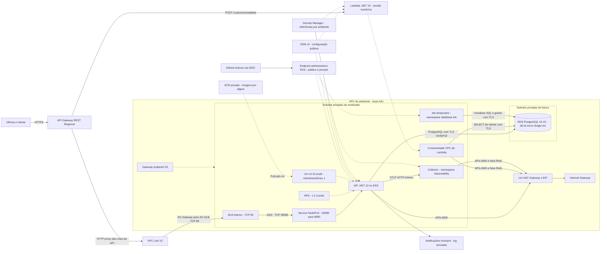
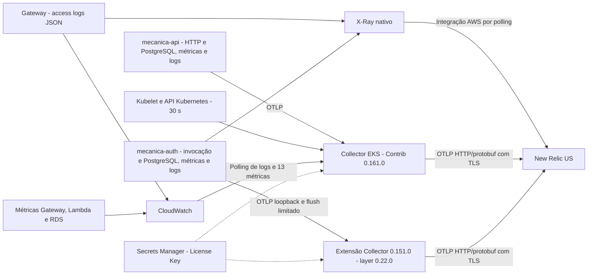

# Componentes e fronteiras

[Arquitetura](../README.md) · [Execução](../rfcs/001-EXECUCAO.md) · [Entrega](../rfcs/002-ENTREGA.md)

Revisão de 21/10/2026 contra os quatro repositórios. O desenho representa a configuração implantada e validada em **hom**, removida ao encerrar a E6. Há configuração própria para prd, mas sua operação e a coexistência dos ambientes não foram comprovadas. [Evidências e estado final](../../ENCERRAMENTO_E6_E_CUSTOS_2026-10-21.md).

O Job está no namespace `database-init`, no mesmo nó privado do EKS. A Lambda é um serviço gerenciado com conectividade VPC, não um pod. RDS não é publicamente acessível. Terraform da base administra NLB/listener/target group e associação ao ASG; não há Load Balancer Controller. O health do target usa HTTP `/health/ready` em 30080; o Service usa `externalTrafficPolicy: Cluster`.

HPA escala pods, não nós. Nó único, NAT único e RDS Single-AZ não oferecem alta disponibilidade entre AZs. Gateway encaminha o Bearer sem authorizer JWT; a API valida assinatura, emissor, audiência, prazo, perfil e vínculo quando exigido. Probes, Swagger e OpenAPI não são publicados pelo Gateway. O endpoint de negócio fica em `/mecanica/<ambiente>/gateway/v2/endpoint` e muda após recriação.

## Propriedade e ciclo de vida

| Responsável | Recursos |
|---|---|
| Bootstrap persistente | Estado/artefatos S3, ECR, OIDC, IAM das pipelines/runtime, integração X-Ray e metadados dos Secrets New Relic |
| Base Terraform | VPC/EKS, SGs reservados, NAT/S3 endpoint, NLB/ASG, JWT e Pod Identity API/Collector |
| Banco Terraform e Job | RDS, SG/credenciais de banco, SQL/seeds e grants |
| API | Deployment/HPA/ServiceAccount, imagem, contratos e negócio |
| Auth SAM | Função/versão/alias, logs, egress do SG reservado e SSM auth/v2 |
| Gateway Terraform | REST API, VPC Link V2, integrações, permissão de invocação e logs |

Notificações permanecem no fluxo da API após commit. Hom/prd usam `LoggingEmailSender`, com mensagem fixa e sem entrega real. Localmente, sem `Runtime__Environment`, a API mantém SMTP/MailKit e smtp4dev. [ADR 006](../adrs/006-NOTIFICACOES.md).

## Caminhos de observabilidade

API/Lambda propagam somente W3C `traceparent`: HTTP/invocação → PostgreSQL e logs correlacionados. X-Ray/polling é diagnóstico separado; a árvore única X-Ray/OTLP foi retirada do escopo, não corrigida. A License Key é lida pelos Collectors, não pela API nem pelo workflow. Logs de aplicação não são recoletados por stdout/CloudWatch.

Collector EKS coleta Kubernetes; kubeletstats cobre apenas o nó onde ele roda. CloudWatch tem atraso de dez minutos para métricas e retoma logs pelos últimos cinco minutos após restart, sem checkpoint/replay/deduplicação. Há lacunas aceitas. Três dashboards e cinco alertas pertencem à unidade persistente New Relic. [ADR 005 e limites](../adrs/005-OBSERVABILIDADE.md).
