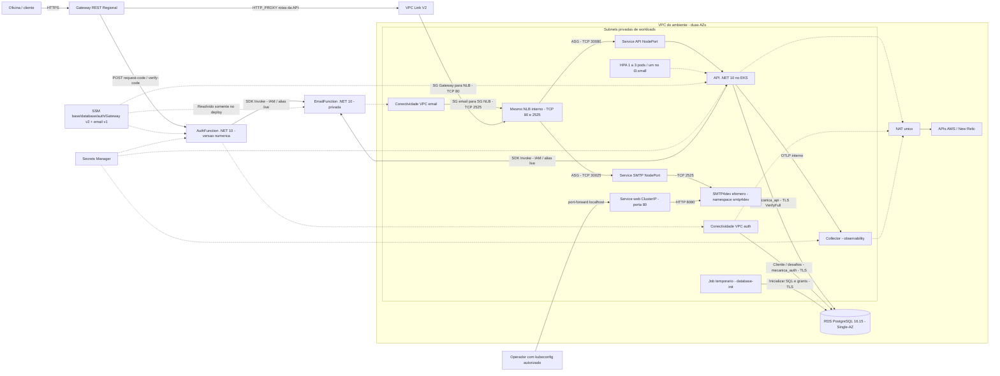
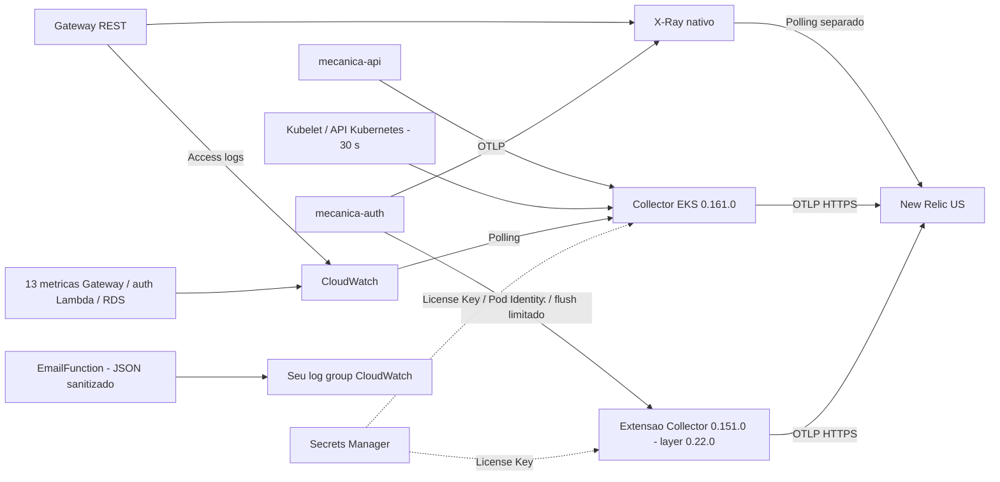

# Componentes e fronteiras

[Arquitetura](../README.md) · [Execução](../rfcs/001-EXECUCAO.md) · [Entrega](../rfcs/002-ENTREGA.md)

Funções são serviços Lambda com conectividade VPC, não pods. Email não possui HTTP público/Function URL/Gateway nem acesso RDS/JWT/Secrets/SSM em runtime. API/auth invocam o alias live por IAM; Gateway integra a versão numérica auth. Web SMTP é somente ClusterIP/port-forward autorizado, sem acesso pelo JWT Mechanic. SMTP demonstrativo privado sem TLS/autenticação; SG não cifra conteúdo. Caixa em memória, sem PVC/relay.

NLB/listeners/targets/ASG pertencem à base, sem Load Balancer Controller. HTTP usa 80 → 30080 → API 8080; SMTP usa 2525 → 30025 → pod 2525. SMTP web não tem listener NLB. Nó único, NAT único e RDS Single-AZ não oferecem alta disponibilidade entre AZs; HPA escala pods, não nós.

## Propriedade e ciclo

| Proprietário | Recursos |
|---|---|
| Bootstrap persistente | Estado/artefatos/ECR/OIDC/IAM e metadados New Relic |
| Base Terraform/Kubernetes | Rede/EKS/SG/NLB/ASG, SMTP4dev efêmero, JWT/Pod Identity/Collector e base/v2 |
| Banco Terraform/Job | RDS, credenciais, esquema/seeds/grants e database/v2 |
| API | Imagem/Deployment/HPA/ServiceAccount e regras de OS |
| Serverless auth SAM | AuthFunction/versões/alias/logs/egress e auth/v2 |
| Serverless email SAM | EmailFunction/versões/alias/logs/egress SMTP e email/v1 |
| Gateway Terraform | REST/VPC Link/duas permissões Invoke e logs/gateway/v2 |

Provisionar bootstrap/base → banco e email → API/auth → Gateway. Descartar Gateway → API/auth → banco/email → base. Banco vazio e mensagens são descartáveis; artefatos/IAM/estado compartilhados persistem. [Contratos e bloqueios](../CONTRATOS_ENTRE_REPOSITORIOS.md).

## Observabilidade preservada

EmailFunction possui somente logs JSON no CloudWatch, sem providers OTel, dashboard, alerta ou coleta CloudWatch própria. API/auth mantêm W3C, SQL/logs correlacionados, sanitização e exportação existentes. Não propagar X-Ray como pai OTLP ou afirmar união automática. Código/destinatário/MIME ficam na caixa privada, não nos logs/telemetria.

Coletores leem License Key no Secrets Manager, nunca via API/pipeline. Coleta kubelet cobre o nó do Collector; métricas CloudWatch têm atraso de dez minutos, logs retomam cinco minutos sem checkpoint/deduplicação.
