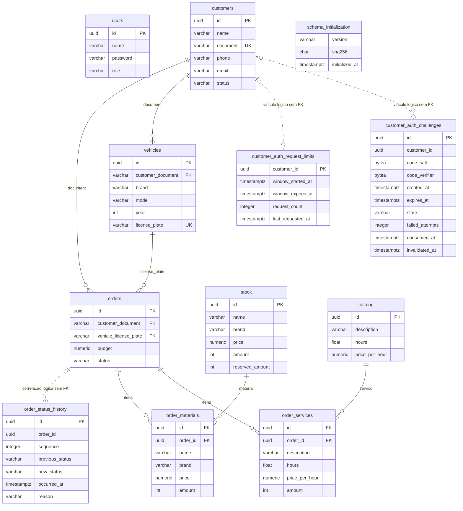

# Modelo físico e histórico de OS

[Justificativa e relacionamentos](../BANCO_E_MODELO.md) · [SQL fonte](https://github.com/pknfelps/GerenciamentoMecanicaBancoDados/blob/develop/sql/Init.sql)

Revisão de 22/10/2026: doze tabelas no Init.sql, incluindo os desafios/limites AE.3 ainda sem aplicação AWS. O ER descreve estrutura e vínculos; comprimentos/defaults/nulabilidade permanecem no SQL e na [documentação do esquema](https://github.com/pknfelps/GerenciamentoMecanicaBancoDados/blob/develop/docs/SCHEMA.md). Regras dos novos registros são implementadas em C#; não há CHECKs de negócio ou cascata.

`users` é independente de clientes/OSs; `password` guarda hash PBKDF2. Customer usa o UUID de `customers` no JWT, sem linha em `users`. As FKs operacionais referenciam documento/placa únicos, preservando o modelo existente; não foram migradas para UUID.

Nos itens, `id` referencia catálogo/estoque, não é PK do item. Não há PK, UNIQUE composto ou cascade nessas tabelas. O código valida os itens e remove as dependências antes de excluir a OS. Descrições, marcas, horas e preços copiados são valores da OS, independentes de alterações posteriores do cadastro original.

A linha pontilhada é somente correlação: `order_id` não tem FK para `orders`. Eventos podem sobreviver ao DELETE da OS. Há PK do evento, mas não CHECK de transições nem UNIQUE/índice de `(order_id, sequence)`; a aplicação protege sequência/estado pela transação e bloqueio da OS. A credencial da API possui DML nas tabelas de domínio, incluindo histórico; preservação não é uma restrição append-only imposta pelos grants.

`schema_initialization` é operacional, isolada do domínio: o Job grava versão/hash/horário na transação do esquema/seeds e exige um marcador compatível em reexecução. Não possui PK no SQL atual. API/auth não recebem acesso a essa tabela pelos grants de aplicação.

`orders` guarda estado e orçamento, sem datas/duração redundantes. Abertura vem de `sequence=1`; conclusão de `Finished/ServiceCompleted`, não da recusa; entrega de `Delivered`. Sem conclusão, `dateFinished`/`duration` são nulos; duração real zero é válida. Destruir o banco encerra esse histórico.

A AuthFunction deve consultar o cliente antes de gravar desafios/limites. Cliente inexistente retorna sem persistência, registrando somente log sanitizado. Tabelas novas usam UUID do cliente, sem FK/cascata, HMAC de documento ou UNIQUE por estado. Validação, consumo, substituição e tratamento dos registros após exclusão de cliente pertencem ao código C#; índices comuns apoiam consulta/limpeza.
