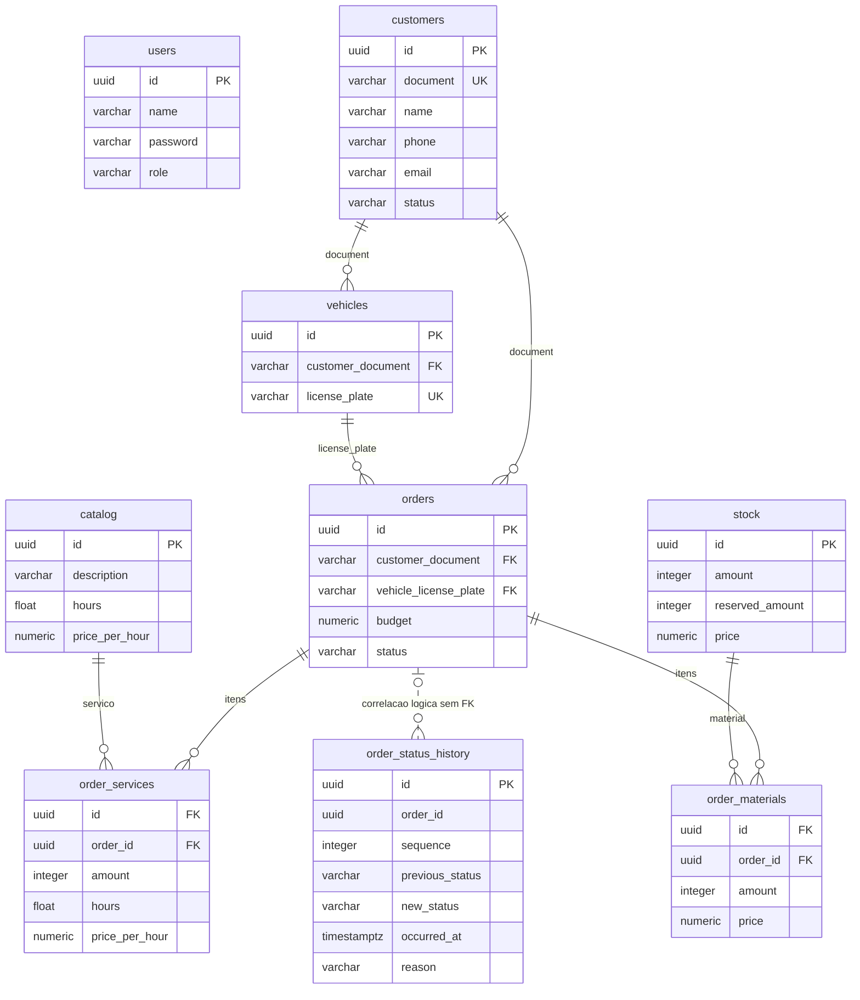

# Dados e histórico de OS

O SQL versionado em `GerenciamentoMecanicaBancoDados/sql/Init.sql` permanece a fonte do esquema. Este diagrama descreve as relações atuais; não cria restrições ou índices.

`users.password` contém o hash. `Customer` é identidade externa ao cadastro de usuários internos; seus JWTs usam o UUID de `customers`. As colunas de itens guardam os valores usados no orçamento, sem depender de alterações futuras do catálogo/estoque.

O vínculo entre histórico e OS é lógico: `order_status_history.order_id` não tem FK para `orders`. Excluir a OS remove seus itens, mas preserva seus eventos e amostras concluídas. Excluir o banco encerra esse histórico. Permanecem as PKs/FKs/UNIQUE/NOT NULL existentes; não há novo CHECK, UNIQUE composto ou índice do histórico.

Criação grava Received/sequence=1 e a OS na mesma transação. Mutações bloqueiam a OS antes de reconstruí-la e validar a operação; status e evento são gravados juntos. As sequências desempatarão instantes iguais. Acesso aos materiais segue ordem consistente de UUID; seus saldos são lidos depois do bloqueio, na transação compartilhada. Exclusão em qualquer estado é atômica. Notificações são disparadas depois da transação da operação; não há promessa de entrega exatamente uma vez de SMTP/telemetria.

Abertura deriva de sequence=1; conclusão de Finished/ServiceCompleted; entrega de Delivered. BudgetRejected não é conclusão do serviço. `dateFinished` e `duration` ficam nulos sem conclusão; duração real zero é válida. Dias/indicadores futuros usam as regras D07, sem tratar ausência como zero nem incluir retirada no tempo de atendimento. As listagens ordenam abertura/UUID; a operacional preserva a prioridade dos estados.

Desempenho sem índice continua sujeito à medição; a ausência de índice é decisão do mantenedor. Testes locais de concorrência e rollback não substituem a conferência SQL/funcional posterior ao deploy em hom.
