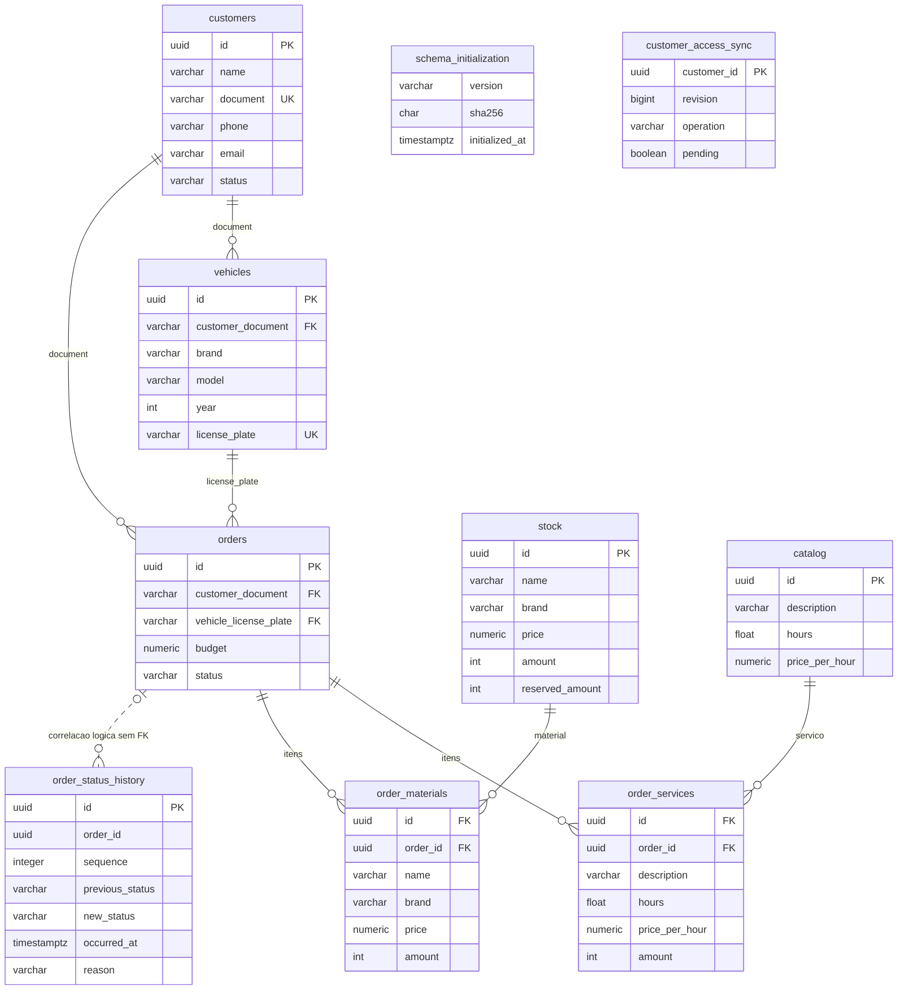
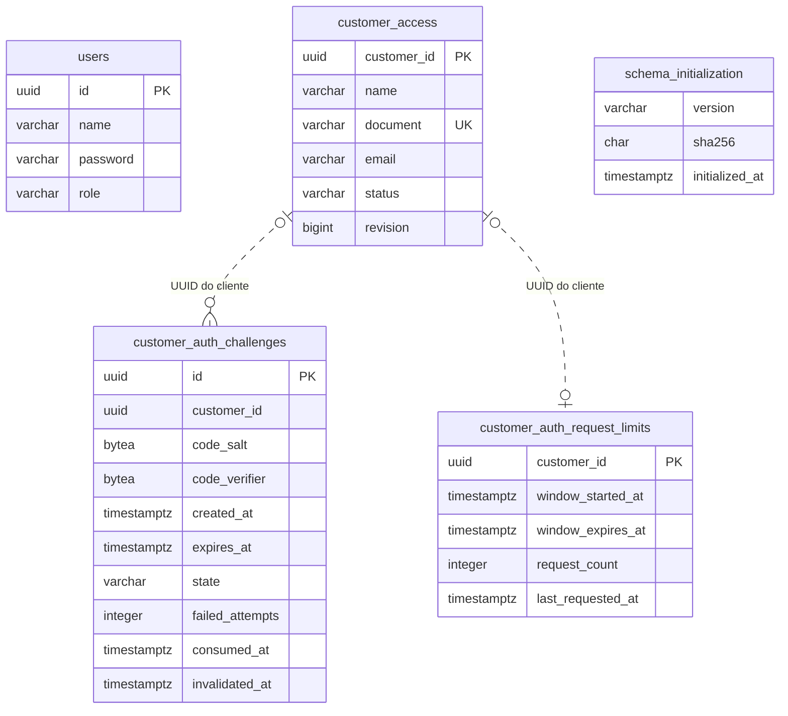

# Modelo físico e histórico de OS

[Justificativa e relacionamentos](../BANCO_E_MODELO.md) · [SQL fonte](https://github.com/pknfelps/GerenciamentoMecanicaBancoDados/blob/develop/sql/Init.sql)

Cada ER representa um database na mesma instância RDS. Tipos, comprimentos, nulabilidade e regras de persistência estão nos respectivos SQLs. Os UUIDs que correlacionam registros entre databases são referências de aplicação.

## Operacional — mecanica

As FKs operacionais referenciam documento e placa únicos, como no modelo existente.

Nos itens, `id` referencia catálogo/estoque, não é PK do item. Não há PK, UNIQUE composto ou cascade nessas tabelas. O código valida os itens e remove as dependências antes de excluir a OS. Descrições, marcas, horas e preços copiados são valores da OS, independentes de alterações posteriores do cadastro original.

A linha pontilhada é somente correlação: `order_id` não tem FK para `orders`. Eventos podem sobreviver ao DELETE da OS. Há PK do evento, mas não CHECK de transições nem UNIQUE/índice de `(order_id, sequence)`; a aplicação protege sequência/estado pela transação e bloqueio da OS. A credencial da API possui DML nas tabelas de domínio, incluindo histórico; preservação não é uma restrição append-only imposta pelos grants.

`schema_initialization` é operacional, isolada do domínio: o Job grava versão/hash/horário na transação do esquema/seeds e exige um marcador compatível em reexecução. Não possui PK no SQL atual. API/auth não recebem acesso a essa tabela pelos grants de aplicação.

`orders` guarda estado e orçamento, sem datas/duração redundantes. Abertura vem de `sequence=1`; conclusão de `Finished/ServiceCompleted`, não da recusa; entrega de `Delivered`. Sem conclusão, `dateFinished`/`duration` são nulos; duração real zero é válida. Destruir o banco encerra esse histórico.

## Identidade — mecanica_identity

`users` guarda apenas as contas Admin/Mechanic, com hash PBKDF2 em `password`. `customer_access` preserva o UUID do cliente operacional para emissão do JWT. Revogação preserva UUID, estado e revisão, com nome, documento e e-mail removidos. Os vínculos pontilhados são correlações por UUID. A sincronização via Invoke mantém a cópia de acesso, com acompanhamento em `customer_access_sync` no database operacional.

A AuthFunction consulta customer_access antes de gravar desafios/limites. Cliente inexistente retorna sem persistência, registrando somente log sanitizado. Tabelas novas usam UUID do cliente, sem FK/cascata, HMAC de documento ou UNIQUE por estado. Validação, consumo, substituição e tratamento dos registros após exclusão de cliente pertencem ao código C#; índices comuns apoiam consulta/limpeza.
