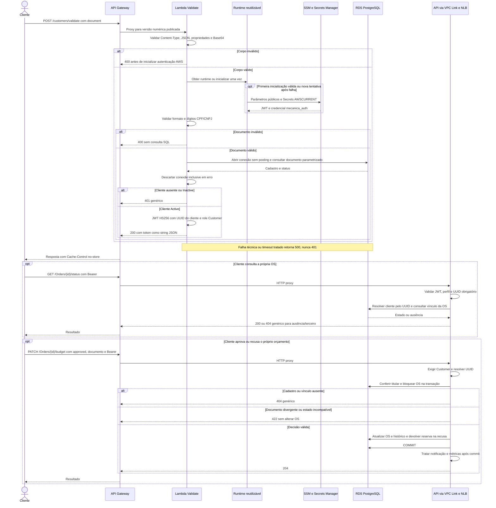

# Validação de CPF/CNPJ e acesso à própria OS

[Arquitetura](../README.md) · [Contrato HTTP/JWT](../ACESSO_E_AUTENTICACAO.md)

Fluxo implementado e conferido em hom. A Lambda valida documento/cadastro, sem senha, e emite JWT Customer; não cria cliente, usuário interno ou OS. O ambiente foi posteriormente removido. [Validação pública](../../VALIDACAO_TRACING_W3C_HOM_2026-10-21.md).

O runtime é inicializado antes da validação do documento pelo caso de uso: **corpo inválido** não inicializa autenticação; **corpo válido com documento inválido** pode inicializá-la, mas não consulta PostgreSQL. A observabilidade é composta antes desse bootstrap e pode existir mesmo numa chamada rejeitada.

O handler limita o processamento ao tempo restante menos um segundo; configuração AWS tem prazo de oito segundos e conexão/comando têm limites próprios, sujeitos ao prazo total. O runtime só guarda inicialização bem-sucedida e pode tentar novamente após falha. O data source é reutilizado como fábrica, com `Pooling=false`; cada consulta abre/fecha sua conexão. Não há leitura de Secret por requisição depois de inicializar com sucesso.

JWT usa HS256, UUID/nome do cadastro, role Customer e expiração UTC + dez minutos. A API mantém sua tolerância de relógio de cinco minutos. Remoção/inativação não revoga tokens emitidos; operações próprias continuam dependendo da existência e vínculo dos recursos. Não há endpoint de inativação na entrega.

400/401 são resultados esperados; falhas técnicas e timeout tratados retornam 500 sanitizado. Erros do próprio Gateway/runtime podem ter formato diferente. O contrato detalha também 401/403 e validação dos argumentos da API. Nenhum documento, token ou credencial é registrado nos logs.
