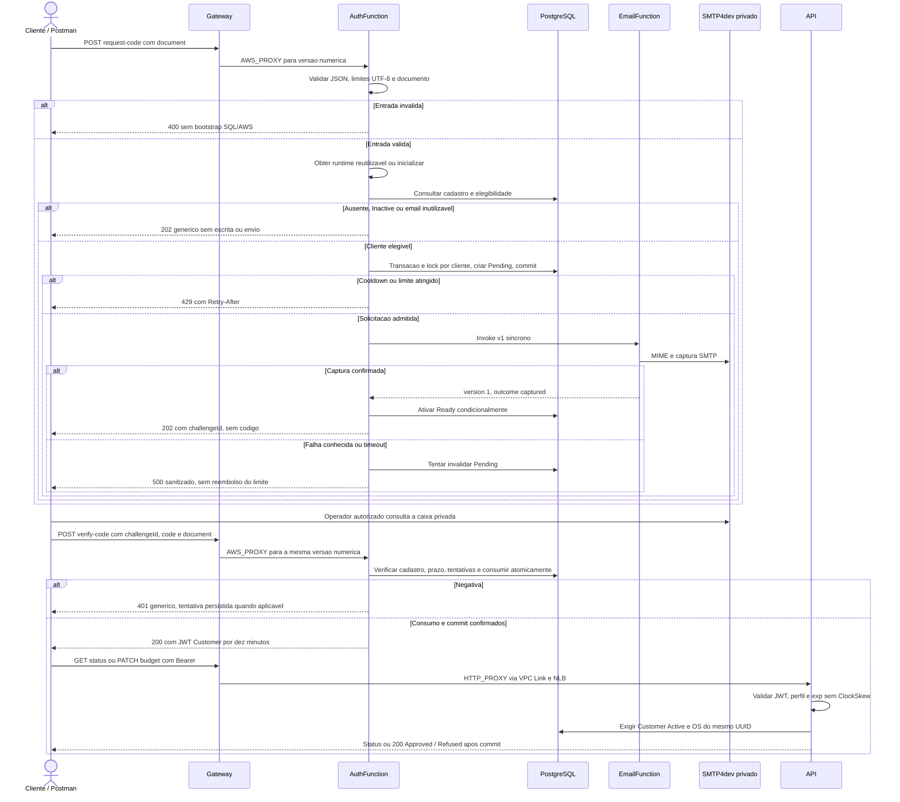

# Documento, código de acesso e operações Customer

Bootstrap real exige hom/prd/us-east-1. Auth carrega dois lotes SSM (nove base/banco, dois email/v1), duas credenciais Secrets e reutiliza o runtime saudável. Prazo de configuração: oito segundos, subordinado ao tempo restante menos um segundo; flush compartilhado existente permanece limitado. Documento/JSON inválidos não iniciam autenticação. Localmente configuração é injetada, sem fallback produtivo de banco/JWT.

Não manter transação durante Invoke/SMTP. Código tem oito dígitos, cinco minutos e cinco tentativas; cooldown de 60 s/cinco pedidos por hora para cliente existente/elegível. Pending não autentica; confirmação consome uma vez. Banco guarda salt/verificador, nunca o código em texto puro. Limpeza oportunista é limitada a 100 expirados por tabela após solicitação admitida, sem job/migration.

O mesmo JWT serve status e orçamento; a Lambda não consulta OS. CPF/CNPJ não aparece no JWT ou orçamento. Cliente inativado após emissão é bloqueado na API. Mensagem capturada pode ser perdida após reinício; pedir outra respeitando limites. Captura não é entrega externa, autenticação por caixa pessoal ou garantia única. Código/token/documento não entram em logs ou evidências.
